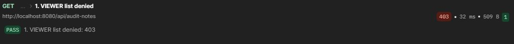
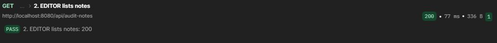
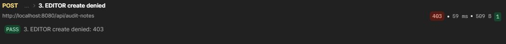
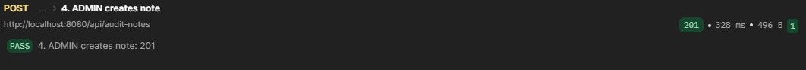
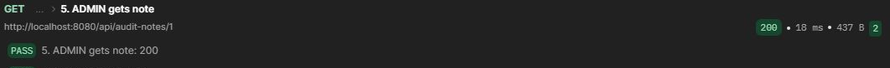

# Audit notes: five JWT requests

Run the [Postman collection](../../postman/audit-notes-jwt.postman_collection.json) in order. The first three setup requests issue JWTs for `viewer`, `editor`, and `admin`; the five numbered requests use those tokens. Set the collection variables `viewerPassword`, `editorPassword`, and `adminPassword` to the local lab passwords before running. The collection defaults to `http://localhost:8080`.

Postman Runner result: **9 passed, 0 failed, 0 errors** (eight status tests and one note ID test). Each screenshot is a crop of the actual Postman result row, showing the method, route, status, and passing test. The pointer is outside every crop.

| # | JWT role and request | Expected status | Screenshot |
| --- | --- | --- | --- |
| 1 | VIEWER: list notes | 403 |  |
| 2 | EDITOR: list notes | 200 |  |
| 3 | EDITOR: create note | 403 |  |
| 4 | ADMIN: create note | 201 |  |
| 5 | ADMIN: get created note | 200 |  |
